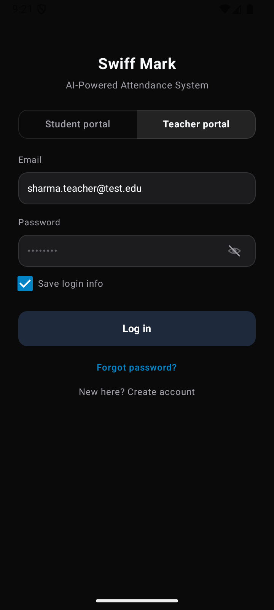
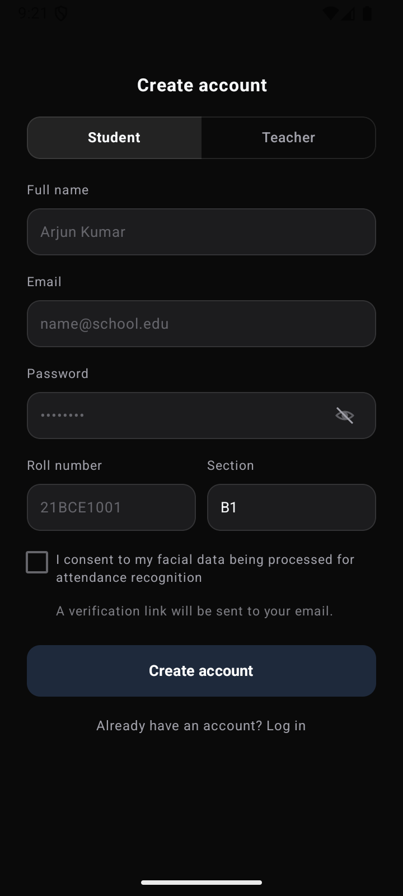

# Swiff Mark

In most college lectures, 10 to 15 minutes get wasted calling out roll numbers or passing around paper sheets that inevitably end up with fake signatures for absent friends.

Swiff Mark is a Facial attendance system built for andriod to eliminate that friction. Instead of manual roll calls, the instructor takes two quick photos of the lecture hall—one when class begins, and one before students leave. The app identifies students in the pictures, matches them against the enrolled class roster on the spot, and marks attendance automatically.

---

## Why We Built It ?

Proxy attendance is an old problem. Students often leave early or ask peers to sign paper registers on their behalf.

To address this without requiring hardware turnstiles or dedicated scanners, Swiff Mark uses a dual-capture verification approach:

1. Start of Class: The instructor takes a wide photo of the room.
2. End of Class: The instructor takes a second photo before students pack up.
3. Matching: If a student appears in both photos, they are marked Present. If someone left halfway or walked in late, they are marked Absent (with a manual override available if the teacher needs to make an exception).

Recognition runs entirely on the teacher's phone in a few seconds, functioning smoothly even when campus Wi-Fi is unstable or offline.

---

## Application Preview

  
  &nbsp;&nbsp;&nbsp;&nbsp;&nbsp;&nbsp;&nbsp;&nbsp;
  

  <em>Teacher Portal Authentication (left) and Account Registration (right).</em>

### Additional Screenshots

- [Session Attendance History](docs/screenshots/teacher_history.png) - Detailed breakdown of students present and absent in each lecture session.
- [Class Roster & Face Confidence Toggles](docs/screenshots/teacher_roster_toggled.png) - Student roster view with face-match confidence scores and manual override switches.
- [Live Attendance Camera Viewfinder](docs/screenshots/teacher_take_att.png) - Dual-capture camera interface with real-time face detection framing.
- [Defaulter Notice Warning Dialog](docs/screenshots/teacher_defaulter_dialog.png) - Automatic calculation of students falling below the mandatory 75% attendance threshold.
- [Instructor Profile Management](docs/screenshots/teacher_profile.png) - Teacher profile view showing department details, subject assignments, and dark theme support.
- [Teacher Navigation Drawer](docs/screenshots/teacher_drawer.png) - Side drawer menu providing fast navigation between classes, profile settings, and logout.

---

## Features

### For Instructors
- Rapid Roll Call: Capture two photos, and the on-device model matches everyone in seconds.
- Class Join Codes: Create a subject, share a unique 6-character join code, and enrolled students populate the roster automatically.
- Visual Verification: See detected faces outlined with color-coded bounding boxes and toggle any individual status with a single tap.
- Session History: Review previous lectures, inspect present and absent tallies, and adjust records if needed.
- Search and Filtering: Filter rosters by student name, roll number, or attendance status. Includes a dedicated filter for students falling below the 75% attendance threshold.
- Official Register Export: Export complete attendance registers to CSV formatted for department records, including date-wise matrices, defaulter summaries, and signature rows for the department head.

### For Students
- Attendance Notifications: Receive notifications showing your attendance status and updated subject percentage following background synchronization.
- Anti-Spam Alerts: Notifications are delivered once per completed session to keep updates clean and uncluttered.
- Personal Dashboard: Track overall attendance and individual course percentages against the mandatory 75% limit.
- Privacy First: Inspect and manage your registered biometric profile directly from your device.

---

## How It Works

Under the hood, recognition runs locally on the mobile device without sending raw photos to external servers:

1. Face Detection: Google ML Kit detects all faces present in the high-resolution classroom photo.
2. Alignment: OpenCV normalizes each detected face chip to standard dimensions using facial landmark geometry.
3. Embedding Generation: TensorFlow Lite processes the aligned face through a mobile-optimized AdaFace neural network, generating a 512-dimensional numerical vector.
4. Cosine Matching: Extracted vectors are compared against enrolled student vectors using nearest-neighbor similarity.
5. Local Storage & Sync: Results are saved immediately to local Room SQLite storage and synced with the cloud database when connectivity is available.

---

## How to Install and Use

Swiff Mark is distributed as a ready-to-use Android application. You do not need to compile or set up development environments to use it.

### Step 1: Download the APK
Download the latest APK release directly to your Android device from the [Releases page](https://github.com/vaavgit/Swiff-Mark/releases/latest).

### Step 2: Install on Your Phone
1. Open the downloaded `.apk` file from your browser or file manager.
2. If prompted by Android, allow installation from this source.
3. Tap Install and wait for completion.

### Step 3: Getting Started
- Launch Swiff Mark and allow Camera permissions when prompted.
- For Teachers: Select Teacher, create your profile, add a class, and share the join code with your students.
- For Students: Select Student, register your account, enter your teacher's class join code, review the biometric consent notice, and complete the quick face enrollment scan.

---

## Tech Stack

- Mobile Platform: Android (API 26+)
- Programming Language: Kotlin
- UI Framework: Jetpack Compose with Material 3
- Asynchronous Processing: Kotlin Coroutines and Flow
- Machine Learning: Google ML Kit (Face Landmark Detection) and TensorFlow Lite (AdaFace 512-D embeddings)
- Computer Vision: OpenCV (Affine transformations and quality checks)
- Local Persistence: Room Database (SQLite) and Android Jetpack DataStore
- Background Tasks: Android Jetpack WorkManager
- Cloud Infrastructure: Supabase (PostgreSQL, Row-Level Security, and Auth)

---

## Privacy and Biometrics

Classroom attendance involves sensitive data, so Swiff Mark is designed around strict privacy protections:

- Explicit Biometric Consent: Students are presented with an explicit informed consent screen prior to face enrollment, adhering to data minimization and purpose limitation principles.
- No Raw Photos in the Cloud: The app never uploads face images or classroom photos to remote servers. Faces are converted directly on the phone into 512-number mathematical vectors.
- Mathematical Feature Embeddings: Faces are represented as 512-dimensional numerical feature embeddings. Camera frames are processed on-device and immediately discarded from memory without permanent retention.
- Ephemeral Classroom Photos: Photos taken during attendance sessions are processed on the teacher's device and deleted immediately after session confirmation or cancellation.
- Right to Erasure: Students can delete their face profile and stored biometric vector at any time through the profile screen.

---

## License

This project is licensed under the [MIT License](./LICENSE).
