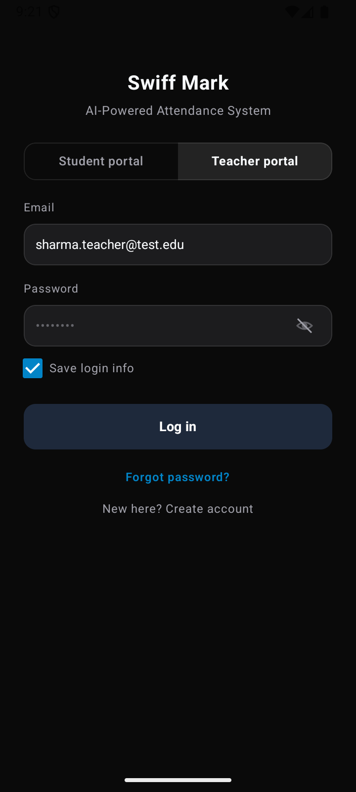
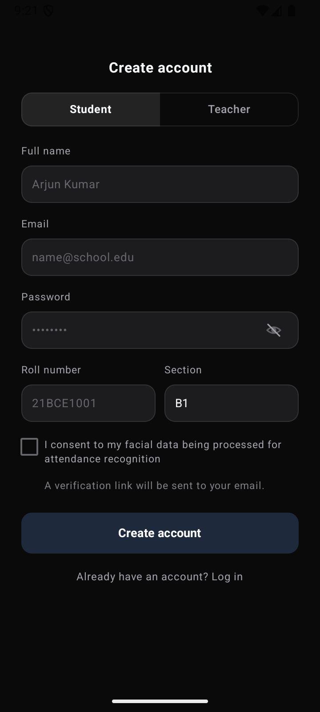

# Swiff Mark

In most college lectures, 10 to 15 minutes get wasted calling out roll numbers or passing around paper sheets that inevitably end up with fake signatures for absent friends.

Swiff Mark is a facial attendance system built for Android that eliminates that friction. Instead of manual roll calls, the instructor takes two quick photos of the lecture hall — one when class begins, and one before students leave. The app identifies students in both pictures, matches them against the enrolled class roster on the spot, and marks attendance automatically.

---

## Why We Built It

Proxy attendance is an old problem. Students often leave early or ask peers to sign paper registers on their behalf.

To address this without requiring hardware turnstiles or dedicated scanners, Swiff Mark uses a dual-capture verification approach:

1. **Start of Class** — The instructor takes a wide photo of the room.
2. **End of Class** — The instructor takes a second photo before students pack up.
3. **Matching** — If a student appears in both photos, they are marked Present. If someone left halfway or walked in late, they are marked Absent (with a manual override available if the teacher needs to make an exception).

Recognition runs entirely on the teacher's phone in a few seconds, functioning smoothly even when campus Wi-Fi is unstable or completely offline.

---

## Application Preview

  
  &nbsp;&nbsp;&nbsp;&nbsp;&nbsp;&nbsp;&nbsp;&nbsp;
  

  <em>Teacher Portal Authentication (left) and Account Registration (right).</em>

### Additional Screenshots

- [Session Attendance History](docs/screenshots/teacher_history.png) — Detailed breakdown of students present and absent in each lecture session.
- [Class Roster & Face Confidence Toggles](docs/screenshots/teacher_roster_toggled.png) — Student roster view with face-match confidence scores and manual override switches.
- [Live Attendance Camera Viewfinder](docs/screenshots/teacher_take_att.png) — Dual-capture camera interface with real-time face detection framing.
- [Defaulter Notice Warning Dialog](docs/screenshots/teacher_defaulter_dialog.png) — Automatic calculation of students falling below the mandatory 75% attendance threshold.
- [Instructor Profile Management](docs/screenshots/teacher_profile.png) — Teacher profile view showing department details and dark theme support.
- [Teacher Navigation Drawer](docs/screenshots/teacher_drawer.png) — Side drawer menu providing fast navigation between classes, profile settings, and logout.

---

## Features

### For Instructors

- **Rapid Roll Call** — Capture two photos and the on-device model matches everyone in seconds.
- **Structured Class Creation** — When creating a class, specify the Department (e.g. BCA, MCA), Course Name (e.g. Artificial Intelligence), Semester, and Class Section (e.g. 5B) separately, so each class card is immediately clear at a glance.
- **Class Join Codes** — Each class gets a unique 6-character code. Share it with students and their enrollment populates the roster automatically.
- **Visual Verification** — See detected faces outlined with color-coded bounding boxes and toggle any individual status with a single tap.
- **Session History** — Review previous lectures, inspect present and absent tallies, and adjust records if needed.
- **Search and Filtering** — Filter rosters by student name, roll number, or attendance status. Includes a dedicated filter for students falling below the 75% threshold.
- **Official Register Export** — Export complete attendance registers to CSV formatted for department records, including date-wise matrices, defaulter summaries, and signature rows.
- **Instructor Profile** — View assigned classes count, faculty ID, department info, and profile photo with circular crop editor. Subjects are automatically derived from the classes you create.

### For Students

- **Personal Dashboard** — Track overall attendance and individual course percentages against the mandatory 75% threshold with live progress rings.
- **Secure Biometric Enrollment** — A four-angle face capture flow (Frontal, Left 3D, Right 3D, Smile / Liveness) guided by real-time pose prompts. The app gives clear directional instructions matching your natural head orientation. All captures are cross-validated pairwise before saving.
- **Re-capture on Failure** — If the biometric validation check detects inconsistent captures, a Re-Capture button appears immediately on the results screen to restart enrollment without navigating away.
- **Attendance Notifications** — Receive notifications showing your attendance status and updated subject percentage after background synchronization.
- **Privacy Controls** — View, manage, or delete your registered biometric face profile at any time from the profile screen. Re-enroll at any time with a single tap.
- **Profile Photo** — Set a custom profile photo with a pinch-to-zoom circular cropper (drag to reposition, pinch to zoom, with rule-of-thirds grid guidance).

---

## How It Works

Recognition runs locally on the mobile device without sending raw photos to external servers:

1. **Face Detection** — Google ML Kit detects all faces in the high-resolution classroom photo.
2. **Alignment** — Each detected face chip is normalized to standard 112×112 dimensions using affine transformations on facial landmark geometry.
3. **Embedding Generation** — TensorFlow Lite processes the aligned face through a mobile-optimized AdaFace neural network, producing a 512-dimensional numerical vector.
4. **Cosine Matching** — Extracted vectors are compared against enrolled student vectors using nearest-neighbor cosine similarity, with 1-to-1 bipartite matching across multiple faces and adaptive thresholds based on face size and classroom distance.
5. **Dual-Capture Cross-Check** — A student must appear in both the start-of-class photo and the end-of-class photo to be marked Present, eliminating single-photo proxy fraud.
6. **Local Storage & Sync** — Results save immediately to local Room SQLite storage and sync with Supabase cloud when connectivity is available.

### Biometric Enrollment Pipeline

Each student completes a guided 4-step enrollment:

| Step | Pose | Purpose |
|------|------|---------|
| 1 | Frontal — look directly at camera | Baseline embedding |
| 2 | Right 3D — turn head to your right | Left side of face profile |
| 3 | Left 3D — turn head to your left | Right side of face profile |
| 4 | Smile / Liveness | Anti-spoof liveness confirmation |

Once your face is aligned inside the oval guide and passes live pose and quality checks, tap **Capture Photo** for each angle. The app processes each frame through AdaFace and runs a pairwise cosine similarity check across all four embeddings to verify they belong to the same person. The final stored embedding is an averaged fusion of all four angles for maximum robustness.

---

## How to Install and Use

Swiff Mark is distributed as a ready-to-use Android application. No compilation or development environment is needed.

### Step 1 — Download the APK

Download the latest release directly to your Android device from the [Releases page](https://github.com/vaavgit/Swiff-Mark/releases/latest).

### Step 2 — Install on Your Phone

1. Open the downloaded `.apk` file from your browser or file manager.
2. If prompted by Android, allow installation from this source.
3. Tap Install and wait for completion.

### Step 3 — Getting Started

**For Teachers:**
1. Select **Teacher** on the welcome screen and register your account.
2. Tap **＋ Create class**, fill in Department, Course Name, Semester, and Class Section.
3. Share the generated 6-character join code with your students.
4. When class starts, tap **📷 Take Attendance** and capture your two classroom photos.

**For Students:**
1. Select **Student** on the welcome screen and register your account.
2. Enter your teacher's join code to enroll in a class.
3. Complete the 4-step face enrollment — follow the on-screen direction prompts and tap **Capture Photo** for each angle.
4. After enrollment, your attendance is tracked automatically every time the teacher runs a session.

---

## Tech Stack

| Layer | Technology |
|-------|-----------|
| Platform | Android (API 26 / Android 8.0+) |
| Language | Kotlin |
| UI | Jetpack Compose with Material 3 |
| Async | Kotlin Coroutines & Flow |
| Face Detection | Google ML Kit Face Landmark Detection |
| Face Recognition | TensorFlow Lite — AdaFace 512-D embeddings |
| Computer Vision | OpenCV (affine alignment & quality checks) |
| Local Database | Room (SQLite) |
| Session Storage | EncryptedSharedPreferences (AES-256-GCM) |
| Background Sync | Android Jetpack WorkManager |
| Cloud Backend | Supabase (PostgreSQL, Row-Level Security, Auth) |
| Camera | CameraX (front camera for enrollment, rear for attendance) |

---

## Privacy and Biometrics

Classroom attendance involves sensitive data, so Swiff Mark is designed around strict privacy protections:

- **Explicit Biometric Consent** — Students are shown a clear informed consent screen before face enrollment, following data minimization and purpose limitation principles.
- **No Raw Photos in the Cloud** — The app never uploads face images or classroom photos to remote servers. Faces are converted on the phone into 512-number mathematical vectors.
- **Mathematical Feature Embeddings** — Faces are stored as 512-dimensional numerical feature vectors. Camera frames are processed on-device and discarded from memory immediately without permanent retention.
- **Ephemeral Classroom Photos** — Photos taken during attendance sessions are processed on the teacher's device and deleted immediately after session confirmation or cancellation.
- **Right to Erasure** — Students can delete their face profile and all stored biometric data at any time from the profile screen.

---

## License

This project is licensed under the [MIT License](./LICENSE).
